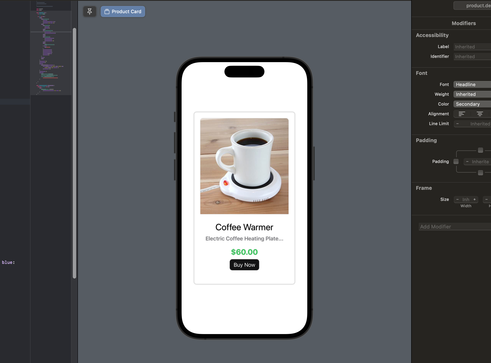

# A/B Testing in iOS with Feature Flags and Amplitude sample app

[Read the blog post here](https://configcat.com/blog/how-to-implement-ab-testing-in-ios/)

In the blog post, we demonstrate how to A/B test an iOS app to determine whether changing the price text color from green to red can increase sales.

We look at an example where our goal is to double sales transactions. With variation A generating 100 sales per month from 50% of users, we introduce variation B to test whether the new color improves sales performance.

The article shows how ConfigCat feature flags simplify A/B testing by letting us split users between variations, while Amplitude helps us track and compare results.

## Build & Run

### Prerequisites

- A Mac computer
- The latest version of Xcode

### How to run the app

1. Clone this repository
2. Open the `ab-testing-ios-sample.xcworkspace` file with Xcode
3. You should be able to see a preview of the app by selecting **ProductView** in the left sidebar

## Learn more

- [Swift Documentation](https://developer.apple.com/swift/) - learn about Swift.

[**ConfigCat**](https://configcat.com) also supports many other frameworks and languages. Check out the full list of supported SDKs [here](https://configcat.com/docs/sdk-reference/overview/).

You can also explore other code samples for various languages, frameworks, and topics here in the [ConfigCat labs](https://github.com/configcat-labs) on GitHub.

Keep up with ConfigCat on [Twitter](https://twitter.com/configcat), [Facebook](https://www.facebook.com/configcat), [LinkedIn](https://www.linkedin.com/company/configcat/), and [GitHub](https://github.com/configcat).

## Author

[Chavez Harris](https://github.com/codedbychavez)

## Contributions

Contributions are welcome!

# Feature Flags in Microservices and Serverless Architecture (AWS Lambda and .NET)

**[Read the blog post here](https://configcat.com/blog/feature-flags-aws-lambda-dotnet/)**

A sample app demonstrating how to use [ConfigCat feature flags](https://configcat.com) in an AWS Lambda function running on .NET.

## Prerequisites

Before getting started, make sure you have the following:

- A Mac computer to build and run the iOS application using Xcode.
- The latest version of [Xcode](https://developer.apple.com/xcode/) installed.
- Basic knowledge of [Swift](https://developer.apple.com/swift/).

## Build & Run

Instructions for building and running the application locally.

1. Open the project in Xcode and add your [ConfigCat SDK Key](https://app.configcat.com/sdkkey) and your Amplitude project API key to the `MyApp.swift` file.

2. Click on the "Play" icon to build and run the app.

3. Tap the **Buy Now** button a few times. Navigate to the **Sources** page in Amplitude, then click on the **Ingestion Debugger** tab to check if the events are successfully logged to Amplitude.

## Learn more

Useful links to technical resources:

- [Swift Documentation](https://docs.swift.org/latest/documentation/)
- [ConfigCat Swift (iOS) SDK documentation](https://configcat.com/docs/sdk-reference/ios/)

[**ConfigCat**](https://configcat.com) supports many other frameworks and languages. Check out the full list of supported SDKs [here](https://configcat.com/docs/sdk-reference/overview/).

You can also explore other code samples for various languages, frameworks, and topics in [ConfigCat labs](https://github.com/configcat-labs) on GitHub.

Keep up with ConfigCat on [X](https://x.com/configcat), [Facebook](https://www.facebook.com/configcat), [LinkedIn](https://www.linkedin.com/company/configcat/), [GitHub](https://github.com/configcat), and the [News & Product Updates](https://configcat.com/docs/news/) page.

## Authors

- [Chavez Harris](https://github.com/codedbychavez)

## Contributions

Contributions are welcome!